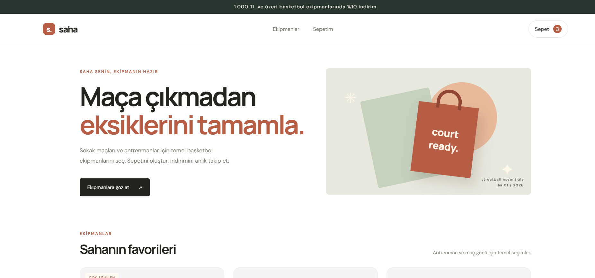
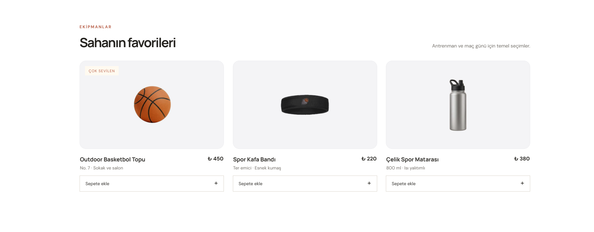
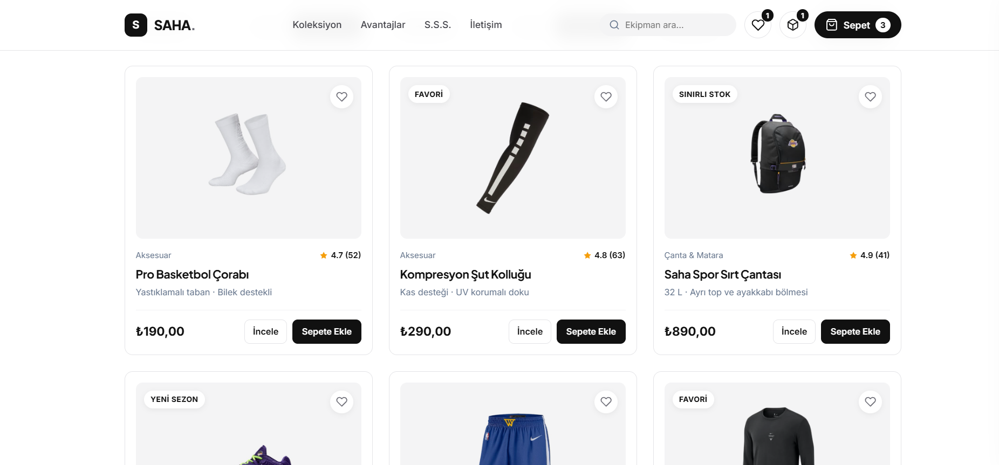

# 🏀 Saha — Basketbol Ekipmanları Sepet Uygulaması
🔗 **Canlı Demo:** [Saha Sepet Uygulamasını Görüntüle](https://yusufobenay.github.io/saha-sepet-projesi/)

HTML, CSS ve JavaScript kullanılarak geliştirilmiş temel bir e-ticaret sepet uygulaması. Proje kapsamında mevcut JavaScript mantık ve hesaplama hataları giderilmiş, mağaza basketbol ekipmanları temasına uyarlanmış ve ek sepet özellikleri eklenmiştir.

## ✨ Özellikler

- **Sepet Yönetimi:** Ürün ekleme, adet artırma/azaltma, tekil ürün silme ve **Sepeti temizle** butonu ile tek seferde boşaltma.
- **Dinamik Hesaplama:** Ara toplam, 1.000 TL ve üzeri alışverişlerde otomatik %10 indirim, %20 KDV ve genel toplam hesaplaması.
- **Anlık İndirim Takibi:** 1.000 TL indirim sınırına ne kadar kaldığını sepet tutarına göre canlı gösteren bilgilendirme alanı.
- **Doğrulama ve Bildirimler:** Boş sepetle sipariş verilmesini engelleyen kontrol ve her işlemde ekranda beliren toast bildirimleri.

## 📁 Proje Yapısı

```text
saha-sepet-projesi/
├── index.html
├── css/
│   └── style.css
├── js/
│   └── app.js
├── img/
│   ├── ball.png
│   ├── headband.png
│   ├── bottle.png
│   ├── 1.png
│   ├── 2.png
│   └── 3.png
├── GOREV.md
├── GOREV-KOD-OKUMA.md
└── README.md
```

### Ana Sayfa


### Ürün Listesi


### Sepet ve Sipariş Özeti

